# Manual do Usuário do SIMAP

Este manual mostra como usar o SIMAP em cada perfil: coordenação, docente e discente.
As telas foram capturadas com os dados fictícios do comando `popular_dados`; nomes,
turmas e notas não são de pessoas reais.

## Sumário

1. [Acesso ao sistema](#1-acesso-ao-sistema)
2. [Coordenação](#2-coordenação)
3. [Docente](#3-docente)
4. [Discente](#4-discente)
5. [Dúvidas frequentes](#5-dúvidas-frequentes)

---

## 1. Acesso ao sistema

### 1.1 Entrar

1. Abra o endereço do SIMAP no navegador.
2. Informe o **usuário de acesso** e a **senha** e clique em **Entrar no sistema**.
3. Se esqueceu a senha, clique em **Esqueceu a senha?** e informe o e-mail cadastrado.
   O link recebido vale por 1 hora e só pode ser usado uma vez.

Se você abriu um link enviado por alguém (por exemplo, o link de presença) e ele é de uma
tela de outro perfil, depois do login o SIMAP leva você ao seu próprio painel.

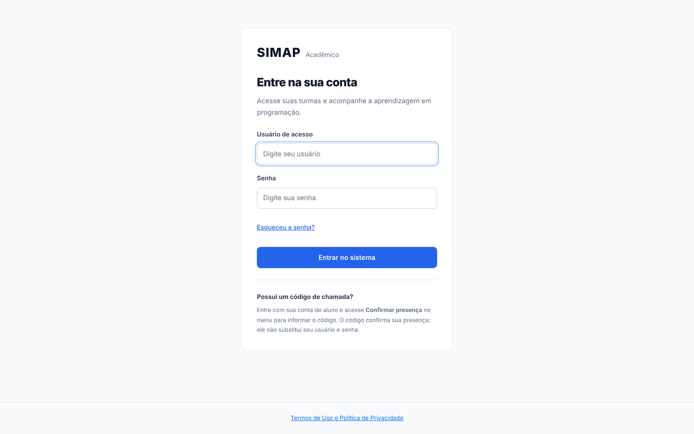

### 1.2 Primeiro acesso

A conta é criada pela coordenação com uma **senha temporária**. No primeiro acesso:

1. Informe a senha temporária e escolha a sua senha pessoal (mínimo de 10 caracteres,
   não pode ser só números nem parecida com seus dados).
2. Leia e aceite os **Termos de Uso e a Política de Privacidade**. Sem o aceite, o sistema
   não libera as outras páginas.

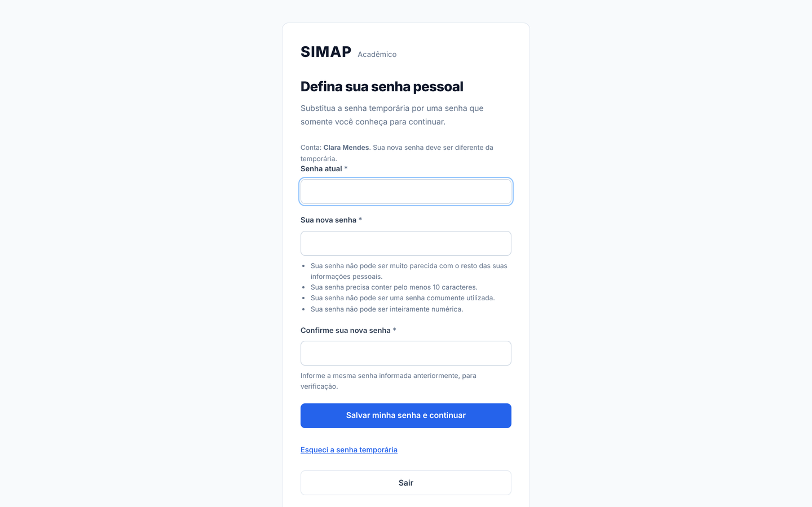

### 1.3 Quando os termos de uso mudam

A coordenação pode publicar uma nova versão dos termos. Quando isso acontece:

1. Se você estiver usando o SIMAP, a tela é bloqueada em alguns segundos com o aviso
   **Os termos de uso foram atualizados**. Não é preciso recarregar a página.
2. Clique em **Ler e aceitar os termos**. A tela mostra a versão nova e o quadro
   **O que mudou nesta versão**; o link **Ler Termos de Uso e Política de Privacidade**
   abre o texto completo.
3. Marque a caixa de aceite e clique em **Aceitar e continuar**. Você volta para a página
   em que estava.

Enquanto a nova versão não for aceita, nenhuma página do sistema é liberada. Quem não
estava usando o sistema vê a mesma tela no próximo acesso. No editor de código, o rascunho
é salvo automaticamente, mas o que for digitado depois do aviso pode não ser salvo.

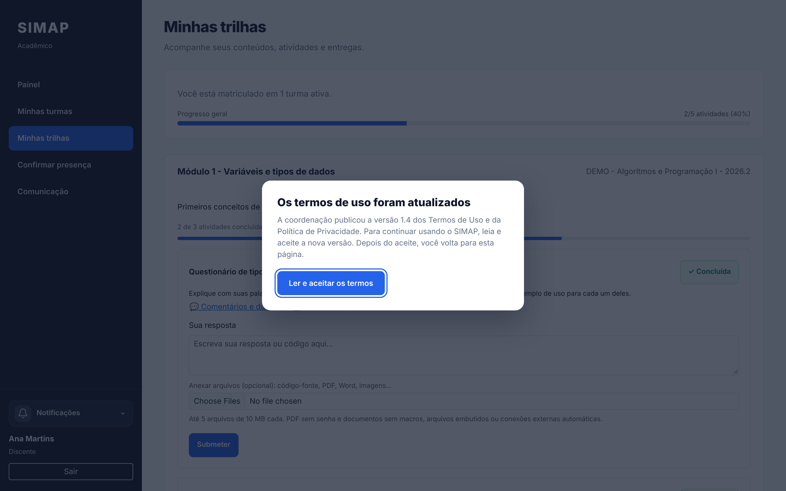

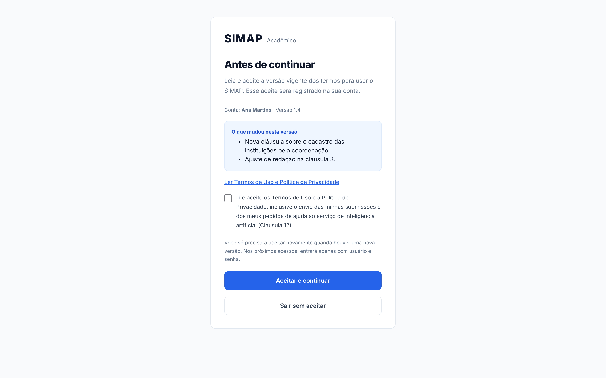

### 1.4 Navegação

O menu lateral muda conforme o perfil. Em todos eles há o sino de **Notificações**,
o nome do usuário e o botão **Sair**. A sessão expira após 8 horas sem uso.

---

## 2. Coordenação

### 2.1 Consultar e gerenciar contas

Em **Usuários** ficam as contas de docentes e discentes. É possível filtrar por perfil e
buscar por nome, usuário, e-mail ou RGM.

Para proteger os dados pessoais, a lista mostra o e-mail e o RGM **mascarados** (por exemplo,
`an***@umc.br` e `***2733`). A busca aceita o dado completo, e a tela de confirmação de
desativar, reativar ou excluir mostra o e-mail e o RGM inteiros, para conferir a conta
antes de alterá-la.

- **Desativar / Reativar:** bloqueia ou libera o acesso sem apagar nada.
- **Excluir:** só é permitido para contas sem histórico. Contas que já entraram no sistema
  ou têm vínculos (turmas, matrículas, entregas, mensagens) devem ser **desativadas**,
  para preservar os registros.

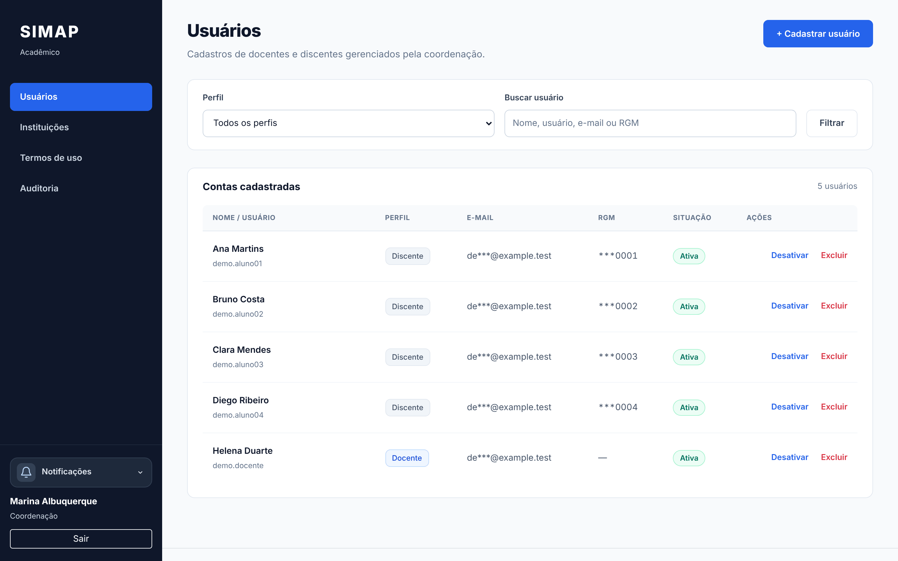

### 2.2 Cadastrar uma conta

1. Clique em **Cadastrar usuário**.
2. Preencha nome, sobrenome, usuário de acesso, e-mail, perfil e a senha temporária
   (o RGM é obrigatório para discentes).
3. Informe a senha temporária à pessoa por um canal privado. Ela será obrigada a trocá-la
   no primeiro acesso.

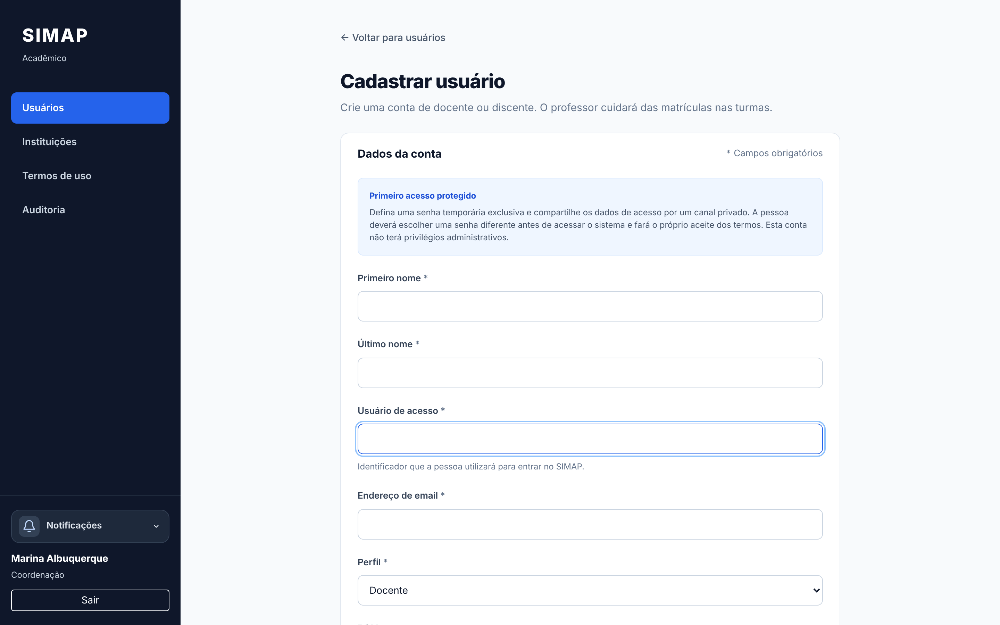

### 2.3 Instituições

A instituição é o local das aulas. A chamada por QR Code usa as coordenadas dela para
conferir se o aluno está perto da sala.

1. Em **Instituições**, clique em **Nova instituição**.
2. Informe o **nome** e as **coordenadas**. Elas podem ser copiadas do Google Maps: clique no
   local e copie o texto que aparece, com a latitude primeiro (por exemplo,
   `-23.517250, -46.182917`). Deixe em branco para não conferir a localização na chamada.
3. Confira o **raio aceito** (de 50 a 1000 metros; padrão 150) e a **precisão mínima aceita**
   (padrão 100 metros). Se o GPS do celular errar mais que isso, a presença vai para análise.
4. Clique em **Salvar instituição**. Em seguida, marque em **Turmas desta instituição** as
   turmas que têm aula nesse local e salve de novo. A busca acima da lista filtra por turma,
   período ou docente.
5. Para cadastrar uma turma já ligada à instituição, use **Nova turma** e escolha o docente
   responsável.

Cada turma pertence a uma instituição só. Na lista aparecem apenas as turmas desta instituição
e as que ainda não têm nenhuma. Turmas sem instituição com coordenadas fazem a chamada sem
conferir a localização.

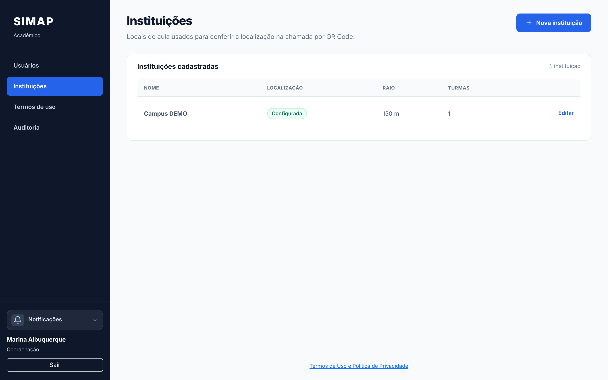

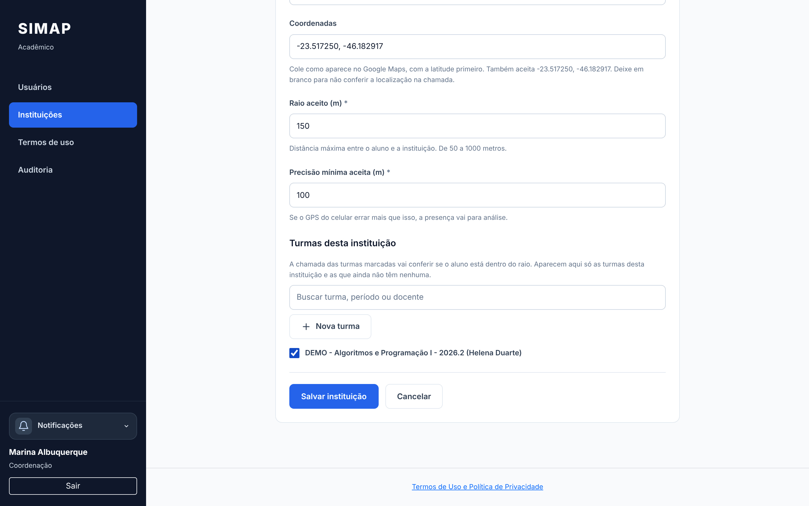

### 2.4 Termos de uso

Em **Termos de uso** a coordenação publica as versões dos Termos de Uso e da Política de
Privacidade. O histórico mostra cada versão, quando e por quem foi publicada e quantas contas
já a aceitaram (na vigente, o total em relação às contas ativas). **Ver texto** abre o texto
de qualquer versão, inclusive as anteriores.

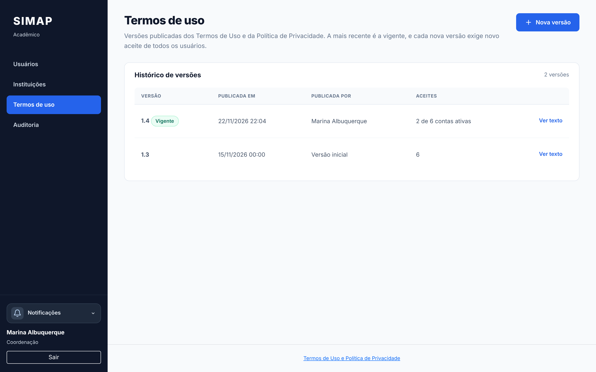

Para publicar uma nova versão:

1. Clique em **Nova versão**. O formulário já vem com o texto da versão vigente e o próximo
   número (por exemplo, 1.4).
2. Preencha **O que mudou nesta versão**, um ponto por linha. É o quadro que os usuários veem
   antes de aceitar.
3. Ajuste **Em resumo** e o **Texto integral**. O texto usa marcações simples:
   `# ` abre uma cláusula (numerada sozinha), `## ` um subtítulo, `- ` um item de lista,
   `> ` uma citação, `---` o rodapé, e `**negrito**` ou `*itálico*`. Deixe uma linha em
   branco entre os parágrafos.
4. Clique em **Pré-visualizar** para ver a página como os usuários vão ver.
5. Marque a confirmação e clique em **Publicar versão**.

Depois de publicada, a versão **não pode ser alterada nem apagada**; para corrigir, publique
outra. Todas as contas, inclusive a da coordenação, precisam aceitar a nova versão, como
descrito em [1.3](#13-quando-os-termos-de-uso-mudam).

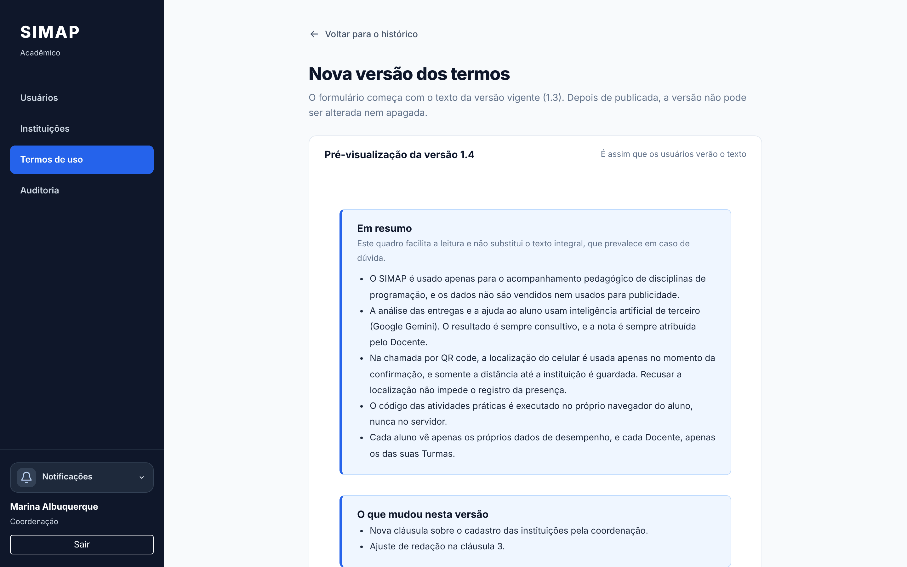

### 2.5 Auditoria

Em **Auditoria** a coordenação consulta quem fez cada ação, quando e de onde, com filtros
e exportação em CSV. Os registros não podem ser alterados e são apagados automaticamente
após 180 dias.

---

## 3. Docente

### 3.1 Painel de desempenho

O **Painel** mostra os indicadores da turma escolhida: frequência, taxa de entrega,
progresso e média de notas, além da quantidade de alunos em atenção. Os gráficos permitem
comparar alunos e acompanhar a evolução. Clique em um aluno para ver o detalhe.

Um aluno fica **em atenção** quando frequência, entregas ou progresso ficam abaixo do
**limite de atenção** da turma (padrão de 60%). Quando isso acontece, o docente também
recebe um e-mail.

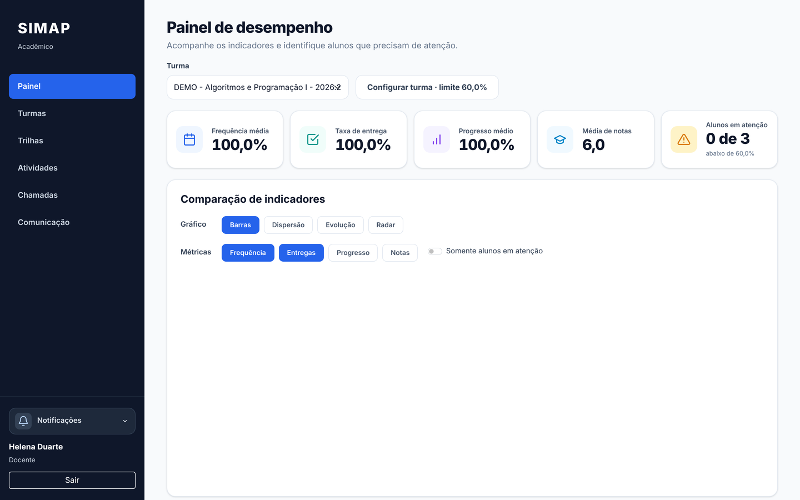

### 3.2 Turmas e matrículas

1. Em **Turmas**, clique em **Nova turma** e informe nome, período, situação e limite de
   atenção. O docente responsável é sempre quem está logado.
2. Para matricular, clique em **Matricular aluno**, escolha uma das suas turmas ativas, um
   discente com conta ativa e a situação da matrícula.
3. Em **Ver alunos** é possível ativar ou inativar matrículas. Só a matrícula ativa dá
   acesso aos conteúdos.
4. Em **Configurar turma** é possível mudar o limite de atenção.

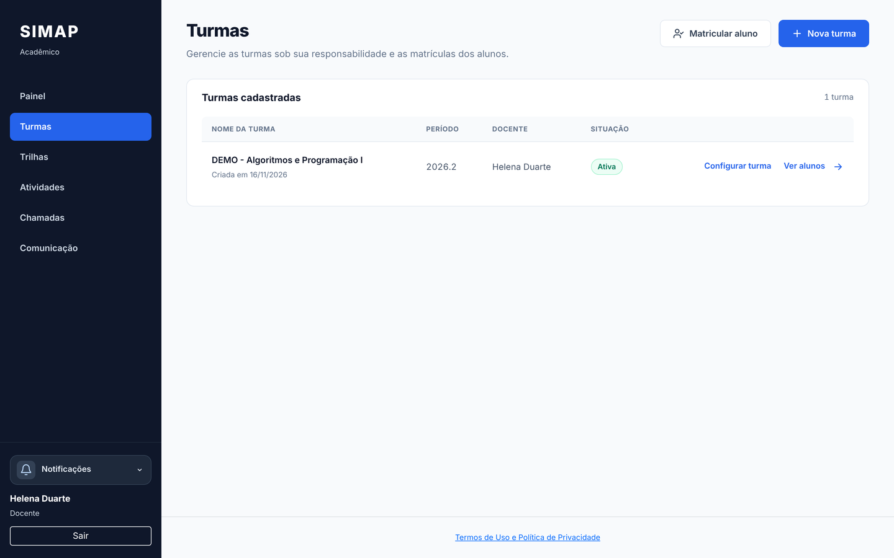

### 3.3 Trilhas e atividades

1. Em **Trilhas**, crie uma trilha para a turma. Deixe-a em **rascunho** enquanto prepara o
   conteúdo; ela só aparece para os alunos quando for **publicada**.
2. Em **Atividades**, crie as atividades da trilha com título, enunciado, tipo, ordem e prazo.
3. Em atividades **práticas**, informe o código inicial e os **casos de teste** (entrada e
   saída esperada). O aluno usa os casos para conferir o código antes de enviar.
4. Em **Ajuda da IA**, ligue ou desligue a ajuda para aquela atividade (por exemplo, em
   provas) e escolha até qual nível de dica ela pode chegar.
5. Trilhas e atividades aceitam **materiais de apoio** (até 5 arquivos de 10 MB por envio) e
   **vídeos do YouTube** (cole o endereço do vídeo).

Ao publicar uma trilha ou atividade, os alunos recebem uma notificação.

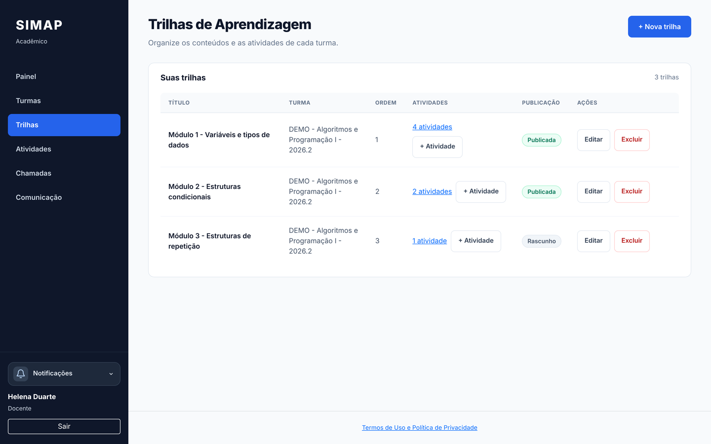

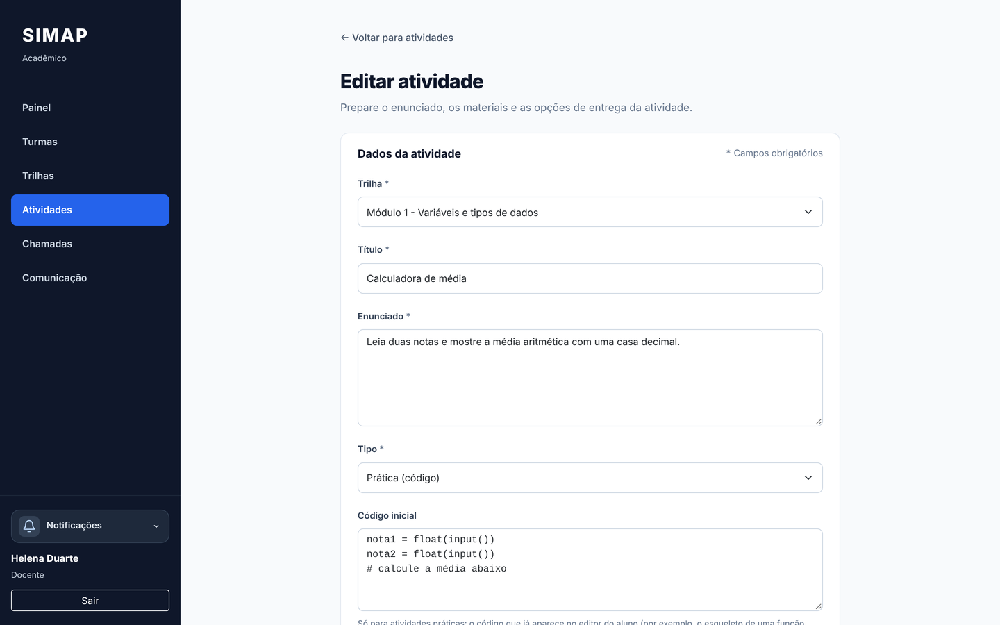

### 3.4 Chamada por QR Code

1. Em **Chamadas**, escolha a turma, o tempo do QR Code (15, 30, 45 ou 60 segundos) e o limite
   de presenças, e clique em **Abrir chamada e gerar QR code**.
2. Clique em **Abrir projeção** e projete o QR Code na sala. O código muda a cada ciclo.
3. Quando o tempo acaba, a chamada fecha; use **Renovar** para gerar um código novo.
4. Presenças **em análise** (fora do raio da instituição, sem localização ou feitas pelo mesmo
   celular de outro aluno) aparecem destacadas: clique em **Aceitar** ou **Recusar**.
5. Clique em **Finalizar chamada** para ver a lista de faltas.

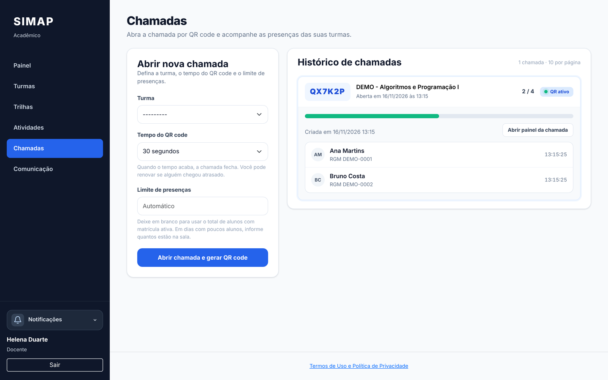

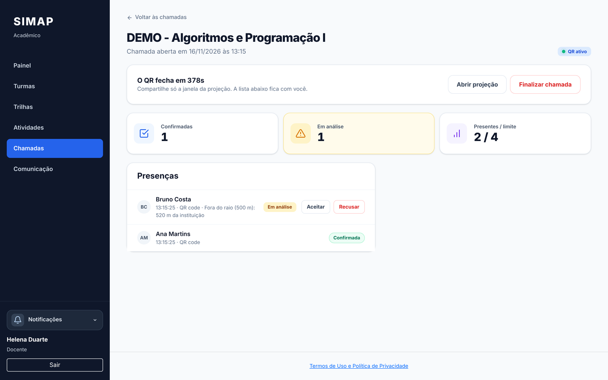

### 3.5 Correção das atividades

1. Em **Atividades**, abra **Corrigir** na atividade desejada.
2. Para cada entrega, leia a resposta, os anexos e o **parecer do sistema** (análise
   consultiva feita pela IA, visível só para o docente).
3. Registre a **nota** (0 a 10) e o **feedback**. O aluno recebe uma notificação e um e-mail
   quando o feedback é publicado.
4. Se o parecer falhar, use **Solicitar nova análise**.
5. Em **Ver pendentes**, envie um lembrete por e-mail aos alunos que ainda não entregaram.

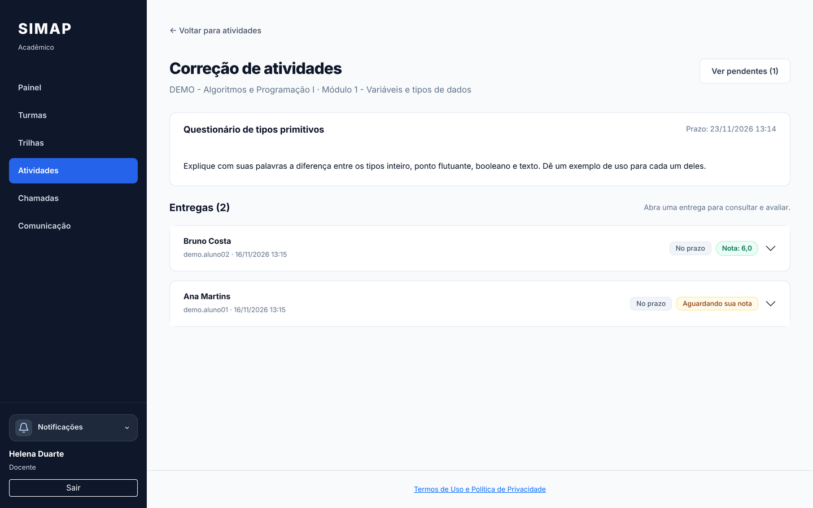

### 3.6 Comunicação

Em **Comunicação**, escolha a turma para abrir o **mural**. É possível publicar avisos para a
turma toda ou mensagens privadas para um aluno, com anexos. As atividades também têm
**comentários**, abertos pelo link "Comentários e dúvidas".

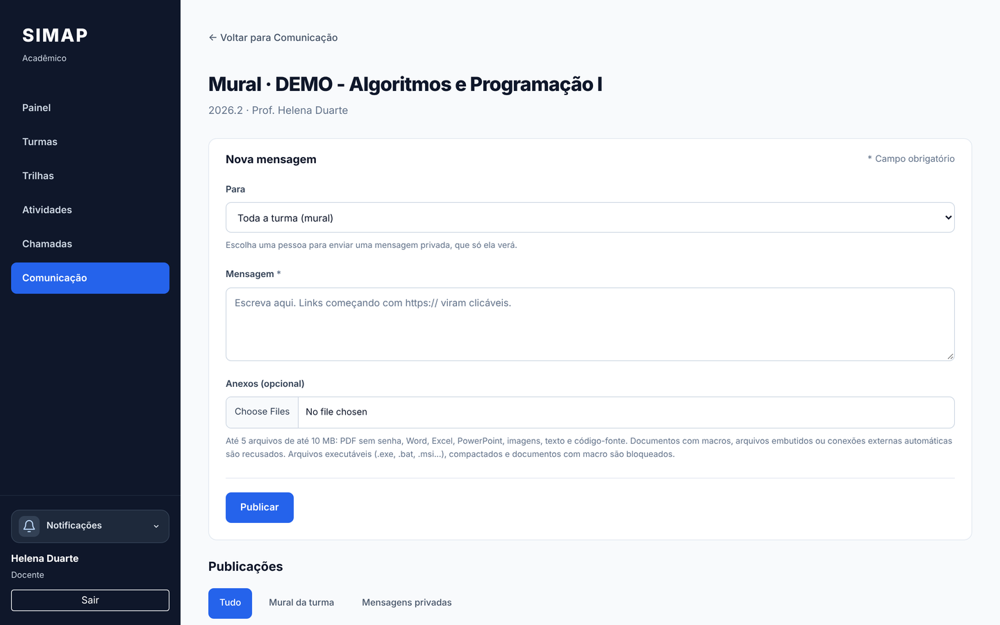

---

## 4. Discente

### 4.1 Meu desempenho

O **Painel** mostra a sua frequência, as entregas, o progresso por trilha e as notas.
Só você e o professor da turma veem esses dados.

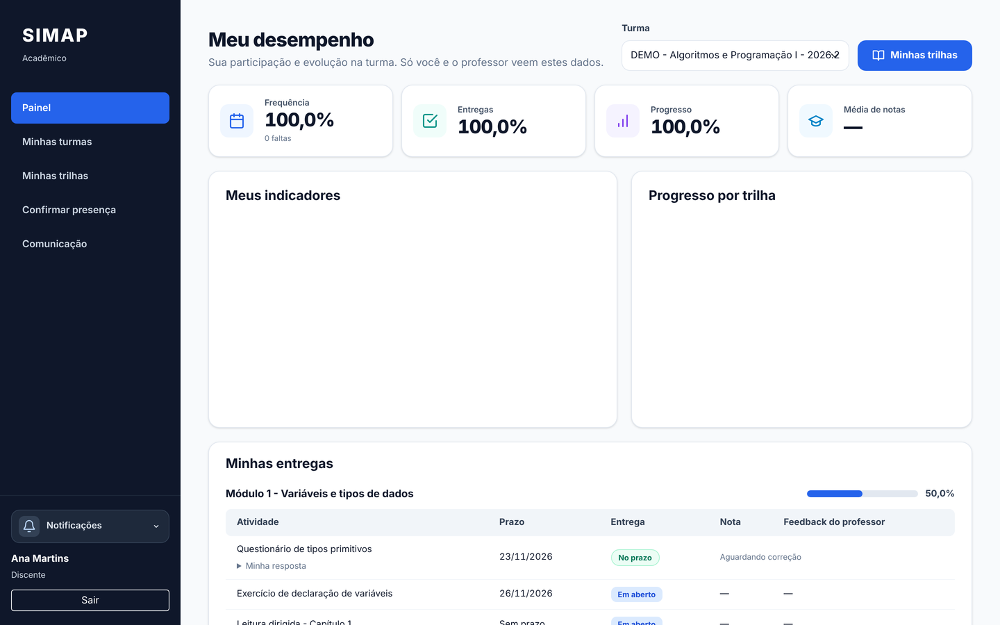

### 4.2 Trilhas e atividades

1. Em **Minhas trilhas**, veja as trilhas publicadas das turmas em que está matriculado.
2. Em atividades teóricas, escreva a resposta, anexe arquivos se precisar e envie. Cada
   atividade aceita **um único envio**.
3. Marque a atividade como **concluída** para acompanhar o progresso.

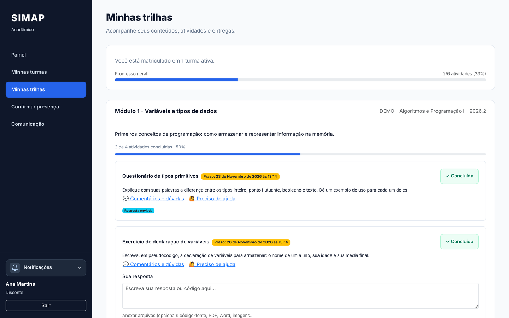

### 4.3 Atividades práticas (editor de código)

1. Abra a atividade prática. O editor já vem com o código inicial do professor.
2. Clique em **Executar** para rodar o código. Se o programa usar `input()`, escreva os valores
   na caixa **Entrada**, um por linha.
3. Clique em **Testar casos** para comparar a saída com os casos de teste.
4. O código é salvo automaticamente como rascunho. Quando estiver pronto, envie a resposta.

O código roda no seu navegador e nunca no servidor. Programas que demoram mais de 10 segundos
são interrompidos.

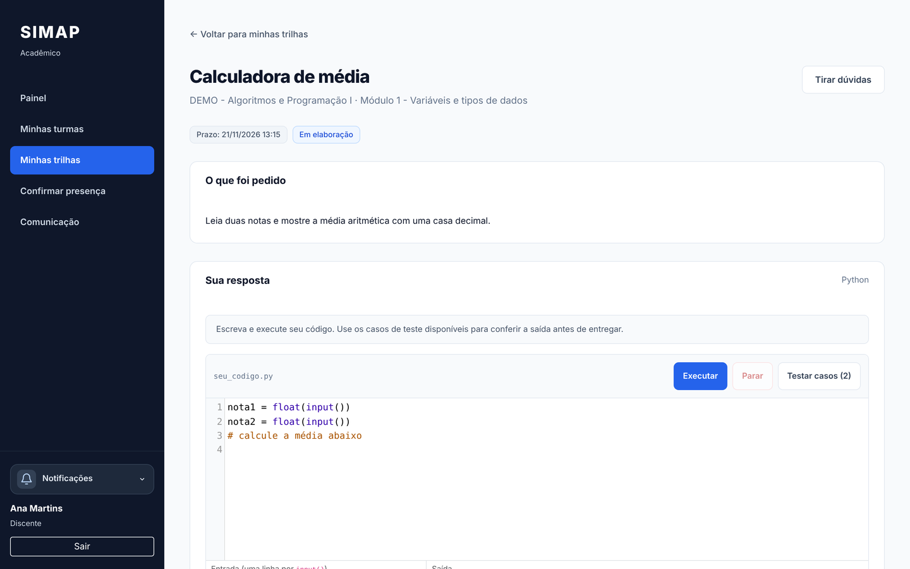

### 4.4 Ajuda da IA

Clique em **Preciso de ajuda** e escolha uma ação: **Me dá uma dica** (em níveis), **Explica o
conceito** ou **Busca material**. No editor, também é possível pedir ajuda para entender um erro
do código. A IA orienta, mas não entrega a solução.

- Há um limite de pedidos por dia em cada atividade e um intervalo entre os pedidos.
- O professor pode desligar a ajuda em algumas atividades e vê quantas vezes você pediu ajuda.

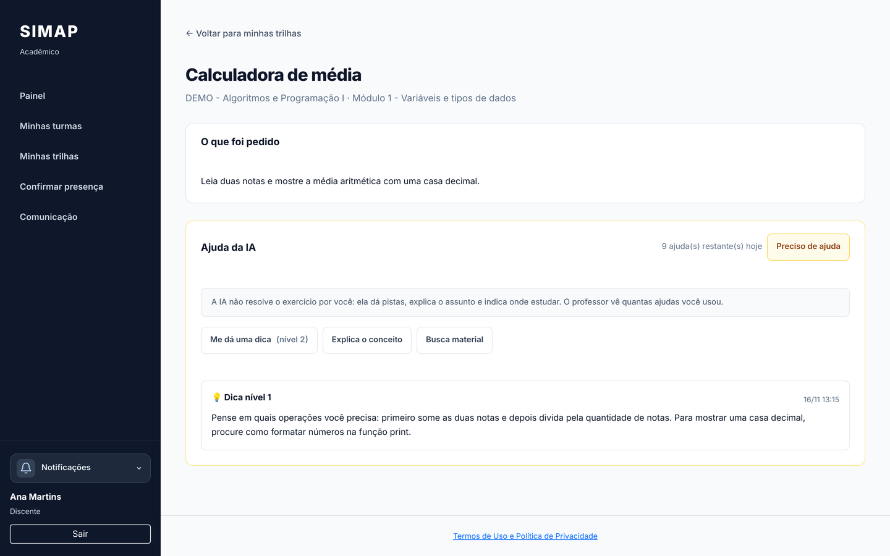

### 4.5 Confirmar presença

1. Aponte a câmera do celular para o QR Code projetado e abra o link.
2. Faça login, se pedido, e confirme a presença em até **3 minutos**. Permita o acesso à
   localização: o sistema guarda só a distância até a instituição, nunca a sua posição.
3. Sem câmera, use **Confirmar presença** no menu e digite o código que aparece abaixo do QR Code.

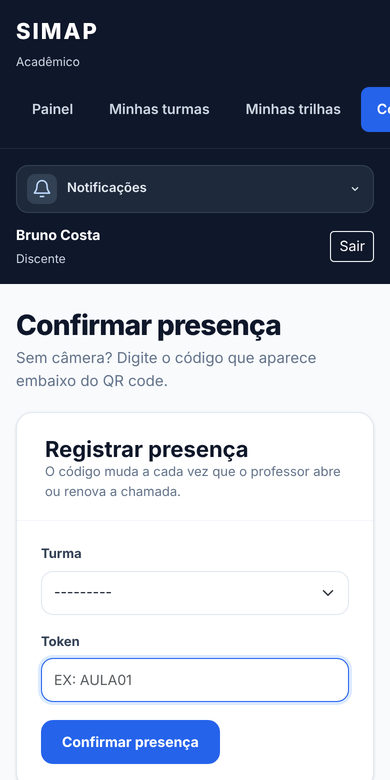

---

## 5. Dúvidas frequentes

**Não consigo entrar.** Confira usuário e senha. Contas desativadas pela coordenação não
entram; procure a coordenação.

**A trilha não aparece para o aluno.** Confira se a trilha e a atividade estão publicadas e
se a matrícula do aluno está ativa.

**A tela ficou escura com o aviso "Os termos de uso foram atualizados".** A coordenação
publicou uma nova versão dos termos. Clique em **Ler e aceitar os termos** e aceite a nova
versão para voltar à página.

**A chamada não está conferindo a localização.** A turma não está ligada a uma instituição
com coordenadas. A coordenação faz o vínculo em **Instituições**.

**A presença ficou "em análise".** A localização não foi confirmada ou o celular já tinha
sido usado por outro aluno. O professor decide se aceita.

**A ajuda da IA não respondeu.** O serviço pode estar indisponível; o pedido que falha não
conta no limite do dia. Tente de novo em alguns instantes.

**O e-mail não chegou.** O SIMAP solicita o envio ao provedor de e-mail, mas a entrega
depende do provedor e da caixa de entrada. Verifique também o spam. As notificações
continuam disponíveis dentro do sistema.
